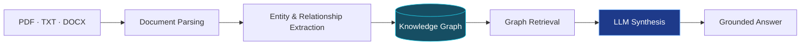

<table>
<tr>
<td width="58%" valign="top">

### 👋 About Me

I'm a Computer Science Engineering graduate and developer interested in building complete software systems — from architecture and backend services to AI-powered applications and user interfaces.

I enjoy exploring how components fit together, how information flows through a system, and how to turn complex ideas into useful products.

</td>
<td width="42%" valign="top">

### 🎯 Focus Areas

- 🧠 RAG &amp; GraphRAG
- 🕸️ Knowledge graphs
- 🏗️ System design &amp; architecture
- ⚙️ Backend engineering &amp; APIs
- 🤖 AI/ML &amp; computer vision
- 📊 Data analytics

</td>
</tr>
</table>

## 🧠 Engineering Interests

## 🏗️ System Thinking

One of my projects explores the difference between standard LLM responses, traditional RAG, and GraphRAG for multi-document question answering.

FastAPI · Streamlit · Knowledge Graphs · Gemini · Multi-hop Reasoning

## ⚒️ Tech Stack

### Languages and Web

### AI, Data, Infrastructure, and Tools

## 🚀 Selected Projects

<table>
<tr>
<td width="50%" align="center">

</td>
<td width="50%" align="center">

</td>
</tr>
<tr>
<td width="50%" align="center">

</td>
<td width="50%" align="center">

</td>
</tr>
</table>

## 📡 GitHub Activity

**Think in systems. Build with purpose. Keep shipping.**

