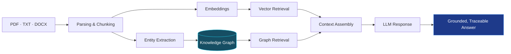

<div align="center">


[](https://github.com/bhuvansmegalamane1)
[](https://github.com/bhuvansmegalamane1?tab=followers)
[](https://github.com/bhuvansmegalamane1?tab=repositories)


</div>

## 👋 About

I'm a **Computer Science Engineering graduate** focused on building practical AI systems, scalable backends, and data-driven applications.

My work spans **Retrieval-Augmented Generation, GraphRAG, knowledge graphs, computer vision, API development, and data analytics**. I care about clean architecture, explainable decisions, reliable data flows, and software that solves real problems.

```text
Architecture  ──►  Data  ──►  Intelligence  ──►  Product
     ▲                                                  │
     └──────────── Feedback & improvement ──────────────┘
```

## 🧭 What I Build

| Area | Direction |
|:---|:---|
| 🧠 **Generative AI** | RAG, GraphRAG, grounded generation, multi-hop reasoning |
| 🕸️ **Knowledge Systems** | Knowledge graphs, entity extraction, document intelligence |
| 🏗️ **System Engineering** | Modular architecture, APIs, backend services, deployment |
| 🤖 **Machine Learning** | Computer vision, classification, data pipelines |
| 📊 **Data & Analytics** | SQL, Python, dashboards, insight generation |

## 🧪 Research Playground

I am exploring how different retrieval architectures affect answer quality across complex document collections.



<div align="center">

[](https://github.com/bhuvansmegalamane1/tigergraph)

<b>FastAPI · Streamlit · Gemini · Knowledge Graphs · GraphRAG</b>

</div>

## ⚒️ Technology Stack

<div align="center">

### Languages &amp; Frameworks


### AI, Data &amp; Infrastructure


<br/>


</div>

## 🚀 Featured Work

<table>
<tr>
<td width="50%" align="center">

[](https://github.com/bhuvansmegalamane1/Detection-and-Classification-of-Diabetic-Foot-Ulcer)

</td>
<td width="50%" align="center">

[](https://github.com/bhuvansmegalamane1/HR-Analytics-Dashboard)

</td>
</tr>
<tr>
<td width="50%" align="center">

[](https://github.com/bhuvansmegalamane1/Retail-Sales-SQL-Pandas-Analysis)

</td>
<td width="50%" align="center">

[](https://github.com/bhuvansmegalamane1/Zenvic_1)

</td>
</tr>
</table>

## 🏆 GitHub Achievements

<div align="center">

<a href="https://github.com/ryo-ma/github-profile-trophy">
  
</a>

</div>

## 📊 GitHub Analytics

<div align="center">


</div>

## 💡 Currently Exploring

- Advanced RAG evaluation and retrieval quality
- GraphRAG and knowledge graph construction
- Agentic workflows and tool-using systems
- Clean backend APIs and deployable AI applications

<div align="center">

[](https://github.com/bhuvansmegalamane1?tab=repositories)

### Think in systems. Build with purpose. Keep shipping.


</div>
