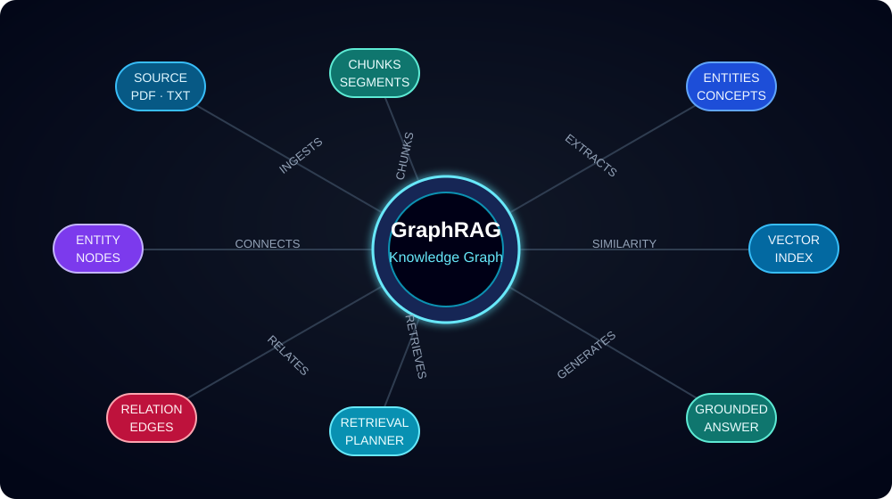

# Hi, I'm Bhuvan 👋

Data analytics, machine learning, and software projects.

## GitHub at a glance

  
  

## Tech stack

  
   
  
  

## Featured projects

| Diabetic Foot Ulcer Classification | HR Analytics Dashboard |
| --- | --- |
|  |  |

| Retail Sales SQL + Pandas Analysis | Interview Insight Analyzer |
| --- | --- |
|  |  |

## Contribution activity

## GraphRAG knowledge network

