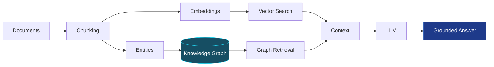

<table>
<tr>
<td align="center" width="25%">🧠 <b>AI / ML</b></td>
<td align="center" width="25%">🕸️ <b>GraphRAG</b></td>
<td align="center" width="25%">⚙️ <b>Backend</b></td>
<td align="center" width="25%">📊 <b>Data</b></td>
</tr>
</table>

## 🧰 My Stack

 

 

## 🕸️ AI Systems

<table>
<tr>
<td width="50%" align="center">

### GraphRAG

**Document → Graph → Retrieval → Answer**

</td>
<td width="50%" align="center">

### RAG

**Chunk → Embed → Retrieve → Generate**

</td>
</tr>
</table>

## 🚀 Selected Work

<table>
<tr>
<td width="50%" align="center">

**AI + Computer Vision**

</td>
<td width="50%" align="center">

**Power BI + Workforce Data**

</td>
</tr>
<tr>
<td width="50%" align="center">

**SQL + Python + Pandas**

</td>
<td width="50%" align="center">

**TypeScript + Web Development**

</td>
</tr>
<tr>
<td width="50%" align="center">

**AI-Assisted Analysis**

</td>
<td width="50%" align="center">

**Python + Audio ML**

</td>
</tr>
</table>

## 📈 GitHub Pulse

