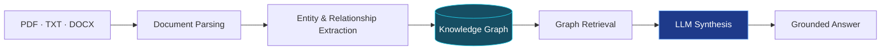

<table>
<tr>
<td width="58%" valign="middle">👋 A little about me
I'm a Computer Science Engineering graduate and developer interested in building complete software systems — from architecture and backend services to AI-powered applications and user interfaces.

I enjoy exploring how components fit together, how information flows through a system, and how to turn complex ideas into useful products.
</td>
<td width="42%" valign="middle">Focus areas
- 🧠 RAG & GraphRAG
- 🕸️ Knowledge graphs
- 🏗️ System design & architecture
- ⚙️ Backend engineering & APIs
- 🤖 AI/ML & computer vision
- 📊 Data analytics
</td>
</tr>
</table>🧠 Engineering interests

🏗️ System thinking
One of my projects explores the difference between standard LLM responses, traditional RAG, and GraphRAG for multi-document question answering.

FastAPI · Streamlit · Knowledge Graphs · Gemini · Multi-hop Reasoning

⚒️ Tech stack

Languages & Web

AI · Data · Infrastructure · Tools

🚀 Selected projects

📡 GitHub activity

Think in systems. Build with purpose. Keep shipping.

