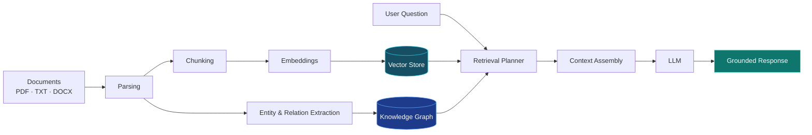

 

## About

> Computer Science Engineering graduate working across software engineering, AI applications, data systems, and GraphRAG.

<table>
<tr>
<td width="50%">

**🤖 AI &amp; Machine Learning**

Computer vision · Machine learning · Knowledge systems

</td>
<td width="50%">

**⚙️ Backend Engineering**

REST APIs · Backend services · System design

</td>
</tr>
<tr>
<td width="50%">

**📊 Data Analytics**

SQL · Pandas · Power BI · Data visualization

</td>
<td width="50%">

**🌐 Software Development**

Python · Java · TypeScript · Web applications

</td>
</tr>
</table>

## Technology

### Languages

### AI · Data · Infrastructure

 

## Featured Work

<table>
<tr>
<td align="center" width="50%">

</td>
<td align="center" width="50%">

</td>
</tr>
<tr>
<td align="center" width="50%">

</td>
<td align="center" width="50%">

</td>
</tr>
<tr>
<td align="center" width="50%">

</td>
<td align="center" width="50%">

</td>
</tr>
</table>

## GraphRAG Architecture

## GitHub

